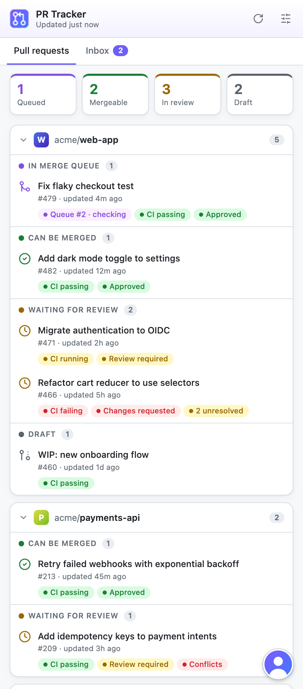

<p align="center">
  
</p>

<h1 align="center">PR Tracker</h1>

A Chrome side panel that shows the state of your open GitHub pull requests, grouped by repository.

<p align="center">
  <picture>
    <source media="(prefers-color-scheme: dark)" srcset="docs/screenshot-dark.png">
    
  </picture>
  <br>
  <sub>Sample data</sub>
</p>

- One collapsible section per repo you choose, collapsed by default (your choice is remembered)
- PRs grouped as **In merge queue**, **Can be merged**, **Waiting for review** and **Draft**
- Status chips for CI, review decision, merge conflicts, unresolved threads and merge-queue position
- A badge on the toolbar icon with the number of open PRs
- Refreshes every minute; light and dark mode
- No backend: everything runs in the extension, talking to the GitHub API directly

Only open PRs **you authored** are shown.

## Download

Download [`pr-tracker.zip`](../../releases/download/latest/pr-tracker.zip), the build of the latest `main`
(rebuilt automatically on every push), and unzip it. Numbered versions are on the
[Releases page](../../releases). Then:

1. Open `chrome://extensions` and turn on **Developer mode**.
2. Click **Load unpacked** and select the unzipped folder (keep it in place, Chrome reads it from there).
3. Click the PR Tracker icon in the toolbar, then follow [Set up sign-in](#set-up-sign-in-one-time).

## Build from source

Requires Node 22+, [pnpm](https://pnpm.io) (npm works too), and Chrome 114+ (for the side panel API).

```sh
pnpm install
pnpm build
```

Then in Chrome:

1. Open `chrome://extensions` and turn on **Developer mode**.
2. Click **Load unpacked** and select the `dist/` folder.
3. Click the PR Tracker icon in the toolbar to open the side panel.

## Set up sign-in (one time)

Sign in with a personal access token (A) or with your own OAuth App (B). Neither needs a server.

### Option A: personal access token

Usually needs no org owner, so it is the quicker route.

1. Create a classic token with the `repo` scope: <https://github.com/settings/tokens/new?scopes=repo&description=PR%20Tracker>
   (the settings page also has a **Create one** link).
   Pick an expiration. When the token expires, the panel shows “Invalid GitHub token”: create a new one and
   paste it in Settings.
2. For an org that uses SSO, click **Configure SSO → Authorize** next to the token.
3. Open the extension's settings (the sliders icon in the panel header) and paste the token under
   **or paste a personal access token**.
4. Click **Connect**. The extension checks the token with GitHub and saves it only if GitHub accepts it.
5. Add the repos to follow, one `owner/name` per line, and click **Save**.

Fine-grained tokens also work, but they can still need approval from the org. Some orgs block classic tokens; if
yours does, use Option B.

### Option B: OAuth App (device flow)

This uses GitHub's [device flow](https://docs.github.com/en/apps/oauth-apps/building-oauth-apps/authorizing-oauth-apps#device-flow), so it needs no client secret.

1. Create an OAuth App at <https://github.com/settings/applications/new>:
   - **Homepage URL** and **Authorization callback URL**: `https://github.com` (the device flow doesn't use them)
   - Tick **Enable Device Flow**
   - Leave **Expire user access tokens** off (the extension doesn't handle refresh tokens)
2. Copy the app's **Client ID** (it is public; you never need the client secret).
3. Open the extension's settings (the sliders icon in the panel header), expand **Advanced**, and paste the Client ID.
4. Click **Sign in with GitHub**. Enter the code it shows on `github.com/login/device`, go through SSO if asked, and authorize.
5. Add the repos to follow, one `owner/name` per line, and save.

### Private repos in an organization

With the OAuth App (Option B), if the org restricts OAuth App access, GitHub hides its data from the app until an
org owner approves it (Org settings → Third-party access → OAuth app policy). Until then the repo's card shows
"GitHub can't see this repo with this sign-in". You can request approval from
<https://github.com/settings/connections/applications>.

A classic token authorized for SSO (Option A) avoids that approval step.

Classic tokens and the OAuth App need the `repo` scope, the only classic scope that reaches private repos; a
fine-grained token needs read access to the repos instead. The extension only runs read queries.

## Development

```sh
pnpm watch       # rebuild on change (reload the extension in chrome://extensions)
pnpm typecheck   # tsc --noEmit
pnpm icons       # regenerate public/icons/*.png from scripts/icons.mjs
pnpm screenshot  # re-render docs/screenshot-*.png from sample data (needs Chrome)
```

```
src/
  background.ts   alarm that refreshes every minute, opens the panel on icon click
  refresh.ts      fetch -> save snapshot -> update toolbar badge
  github.ts       GraphQL query and mapping to PullRequest
  auth.ts         OAuth device flow
  panel.ts        side panel UI
  options.ts      settings page (sign-in, Client ID, repo list)
  storage.ts      chrome.storage helpers
  types.ts
public/           manifest, HTML, CSS, icons (copied to dist/)
```

## Limitations

- Looks at your 100 most recently updated open PRs, then filters to the configured repos.
- Reads up to 100 review threads per PR.
- Merge-queue info only appears for repos that use GitHub's merge queue.

## Privacy

The access token is stored in `chrome.storage.sync` (it syncs across your signed-in Chrome profiles). The extension
only talks to `github.com` and `api.github.com`, plus `avatars.githubusercontent.com` for your profile picture.
Use **Sign out** in the settings to remove the token.

## License

MIT
