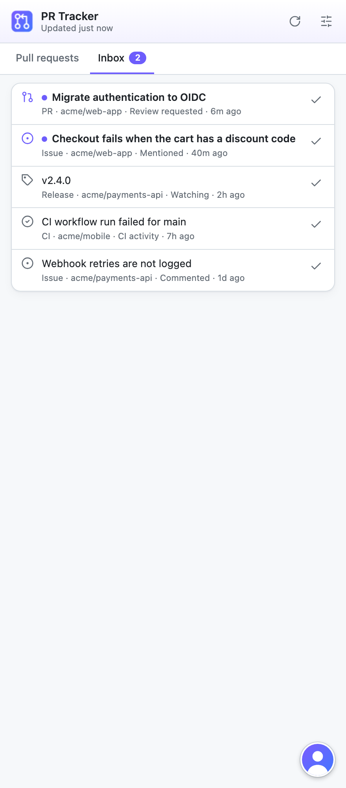

<p align="center">
  
</p>

<h1 align="center">PR Tracker</h1>

A Chrome side panel that shows the state of your open GitHub pull requests, grouped by repository.

<p align="center">
  <picture>
    <source media="(prefers-color-scheme: dark)" srcset="docs/screenshot-dark.png">
    
  </picture>
  <br>
  <sub>Sample data</sub>
</p>

<p align="center">
  <picture>
    <source media="(prefers-color-scheme: dark)" srcset="docs/screenshot-inbox-dark.png">
    
  </picture>
  <br>
  <sub>The Inbox tab (sample data)</sub>
</p>

- Two tabs, **Pull requests** and **Inbox** (with an unread count); the tab you pick is remembered
- One collapsible section per repo you choose, collapsed by default (your choice is remembered)
- Find repos by searching GitHub in the settings (live results from 2 characters; type `owner/` to search within one
  owner; private repos show a lock). Search is debounced, and typing a full `owner/name` offers an **Add** row. The
  order of your list is the order of the panel sections
- Show **Only mine** (default) or **Everyone's (20 latest per repo)**: in Everyone's mode each repo lists its 20 most
  recently updated open PRs with the author's avatar and @login, and yours get an accent marker. A repo with more
  open PRs ends with "Showing 20 of N · View all on GitHub ↗"
- An **Inbox** that mirrors [github.com/notifications](https://github.com/notifications) across all repos: type,
  title, repo, reason and time, with unread rows marked. Click a row to open it on GitHub (it is marked read), or
  **Done** to remove it from your GitHub inbox. Shows the 50 most recent items
- PRs grouped as **In merge queue**, **Can be merged**, **Waiting for review** and **Draft**
- Status chips for CI, review decision, merge conflicts, unresolved threads and merge-queue position
- A badge on the toolbar icon with the number of your open PRs
- Refreshes every minute (the inbox uses a free conditional request, with a full refresh at least every 5 minutes,
  whenever the panel opens and when you click refresh); light and dark mode
- No backend: everything runs in the extension, talking to the GitHub API directly

By default only open PRs **you authored** are shown. In Everyone's mode, PRs of yours that are not among a repo's
20 latest are hidden, but the toolbar badge still counts all your open PRs in the followed repos.

The Inbox reads GitHub's notifications API, which does not accept fine-grained tokens. If your token can't read it,
the panel says so and links to Settings. Classic tokens and the OAuth App sign-in use the `repo` scope, which covers
notifications.

## Download

Download [`pr-tracker.zip`](../../releases/download/latest/pr-tracker.zip), the build of the latest `main`
(rebuilt automatically on every push), and unzip it. Numbered versions are on the
[Releases page](../../releases). Then:

1. Open `chrome://extensions` and turn on **Developer mode**.
2. Click **Load unpacked** and select the unzipped folder (keep it in place, Chrome reads it from there).
3. Click the PR Tracker icon in the toolbar, then follow [Set up sign-in](#set-up-sign-in-one-time).

## Build from source

Requires Node 22+, [pnpm](https://pnpm.io) (npm works too), and Chrome 114+ (for the side panel API).

```sh
pnpm install
pnpm build
```

Then in Chrome:

1. Open `chrome://extensions` and turn on **Developer mode**.
2. Click **Load unpacked** and select the `dist/` folder.
3. Click the PR Tracker icon in the toolbar to open the side panel, then search and add your repos in the settings.

## Set up sign-in (one time)

Sign in with a personal access token (A) or with your own OAuth App (B). Neither needs a server.

### Option A: personal access token

Usually needs no org owner, so it is the quicker route.

1. Create a classic token with the `repo` scope: <https://github.com/settings/tokens/new?scopes=repo&description=PR%20Tracker>
   (the settings page also has a **Create one** link).
   Pick an expiration. When the token expires, the panel shows “Invalid GitHub token”: create a new one and
   paste it in Settings.
2. For an org that uses SSO, click **Configure SSO → Authorize** next to the token.
3. Open the extension's settings (the sliders icon in the panel header) and paste the token under
   **or paste a personal access token**.
4. Click **Connect**. The extension checks the token with GitHub and saves it only if GitHub accepts it.
5. Under **Repositories**, search for the repos to follow and click **+ Add** (or type a full `owner/name` and use the
   **Add** row). Remove one with its ✕, then click **Save**.

Fine-grained tokens also work for pull requests, but they can still need approval from the org, and they can't read the Inbox.
Some orgs block classic tokens; if
yours does, use Option B.

### Option B: OAuth App (device flow)

This uses GitHub's [device flow](https://docs.github.com/en/apps/oauth-apps/building-oauth-apps/authorizing-oauth-apps#device-flow), so it needs no client secret.

1. Create an OAuth App at <https://github.com/settings/applications/new>:
   - **Homepage URL** and **Authorization callback URL**: `https://github.com` (the device flow doesn't use them)
   - Tick **Enable Device Flow**
   - Leave **Expire user access tokens** off (the extension doesn't handle refresh tokens)
2. Copy the app's **Client ID** (it is public; you never need the client secret).
3. Open the extension's settings (the sliders icon in the panel header), expand **Advanced**, and paste the Client ID.
4. Click **Sign in with GitHub**. Enter the code it shows on `github.com/login/device`, go through SSO if asked, and authorize.
5. Under **Repositories**, search for the repos to follow and click **+ Add** (or type a full `owner/name` and use the
   **Add** row), then click **Save**.

### Private repos in an organization

With the OAuth App (Option B), if the org restricts OAuth App access, GitHub hides its data from the app until an
org owner approves it (Org settings → Third-party access → OAuth app policy). Until then the repo's card shows
"GitHub can't see this repo with this sign-in". You can request approval from
<https://github.com/settings/connections/applications>.

A classic token authorized for SSO (Option A) avoids that approval step.

Classic tokens and the OAuth App need the `repo` scope, the only classic scope that reaches private repos; a
fine-grained token needs read access to the repos instead. The `repo` scope also covers notifications, which the Inbox
reads.

## Development

```sh
pnpm watch       # rebuild on change (reload the extension in chrome://extensions)
pnpm test        # unit tests (node:test, bundled with esbuild)
pnpm typecheck   # tsc --noEmit, including test/
pnpm icons       # regenerate public/icons/*.png from scripts/icons.mjs
pnpm screenshot  # re-render docs/screenshot-*.png from sample data (needs Chrome)
SCREENSHOT_TAB=inbox pnpm screenshot  # the same for docs/screenshot-inbox-*.png
```

```
src/
  background.ts   alarm that refreshes every minute, opens the panel on icon click
  refresh.ts      fetch PRs and inbox -> save snapshots -> update toolbar badge
  github.ts       GraphQL query and mapping to PullRequest
  inbox.ts        notifications REST fetch (conditional requests), mark read / done
  auth.ts         OAuth device flow
  panel.ts        side panel shell: tabs, header, refresh
  pr-view.ts      Pull requests tab rendering
  inbox-view.ts   Inbox tab rendering
  dom.ts          small DOM helpers shared by the views
  options.ts      settings page (sign-in, Client ID, repo list, PR scope)
  repo-search.ts  GitHub repo search (debounce, owner/ prefix, results)
  repo-picker.ts  repo search and Following list UI for the settings
  storage.ts      chrome.storage helpers
  types.ts
test/             unit tests (node:test) and a chrome.storage stub; run with pnpm test
public/           manifest, HTML, CSS, icons (copied to dist/)
```

## Limitations

- In "Only mine" mode, looks at your 100 most recently updated open PRs, then filters to the configured repos.
- In Everyone's mode, shows the 20 most recently updated open PRs per repo.
- The Inbox shows the 50 most recent notifications.
- Fine-grained tokens can't read the Inbox (GitHub's notifications API doesn't accept them).
- Reads up to 100 review threads per PR.
- Merge-queue info only appears for repos that use GitHub's merge queue.

## Privacy

The access token is stored in `chrome.storage.sync` (it syncs across your signed-in Chrome profiles). The extension
only talks to `github.com` and `api.github.com`, plus `avatars.githubusercontent.com` for your profile picture.
The extension only reads from GitHub, with one exception: it marks a notification as read or done when you click it
in the Inbox. It also keeps the cached inbox in local storage next to a short hash of the token (never the token
itself) so it can tell accounts apart. Use **Sign out** in the settings to remove the token.

## License

MIT
